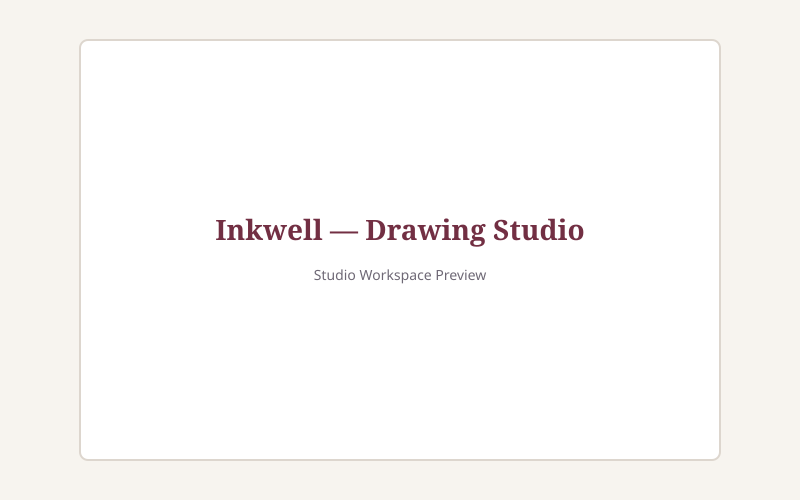

# Inkwell

> An archival, fine-art-inspired browser drawing studio built for deliberate craftsmanship and fluid creative flow.

Live demo: (add after deploy)

---

## Screenshot



---

## Project Overview

**Inkwell** translates the tactile warmth of a physical fine art atelier into a digital workspace. Eschewing the synthetic blurs, harsh neon accents, and cluttered interfaces typical of modern digital creation tools, Inkwell centers on organic workshop tones: warm studio ivory, flaxen beige tool surfaces, archival carbon ink, and rich burgundy lacquer.

Every stroke is captured as a resolution-independent vector stroke command, supporting unlimited non-destructive undo/redo, multi-layer isolation, background paper patterns, and pixel-accurate composited exports.

---

## Features

### Core Drawing & Tools
- **Smooth Freehand Pen**: Uses quadratic Bézier interpolation across pointer sample points for natural, fluid curves without polygonal jaggedness.
- **Layer-Scoped Eraser**: Operates using `destination-out` blending isolated strictly to the active layer, preserving background guidelines and underlying layers.
- **Vector Geometric Shapes**: Live click-drag overlays for Rectangles, Circles, Straight Lines, Triangles, and Directional Arrows. Live preview renders on a dedicated transient canvas and commits to state on pointer release (or cleanly cancels on `Escape`).
- **Pointer Events Pipeline**: Native `pointerdown`, `pointermove`, `pointerup`, and `pointercancel` with pointer capture support across mouse, stylus/pen pressure, and touch surfaces (`touch-action: none`).
- **Color Selection**:
  - 16 atelier-curated palette swatches in a floating popover.
  - Native color picker for arbitrary hex/RGB colors.
  - Composited canvas eyedropper sampling exact pixel values at device pixel ratio (`I`).
- **Brush Sizing**: 1px to 40px continuous slider with live numeric readout and preview dot.

### Multi-Layer Architecture
- **Independent Canvas Stacks**: Each layer is rendered onto its own dedicated, transparent HTML5 canvas element stacked via CSS z-index.
- **Layer Operations**: Add new layers on top ("Layer N"), delete layers (disabled on the sole remaining layer), double-click to rename with inline inputs, toggle visibility, and drag-and-drop reordering.
- **Visual Distinction**: Active layer is accentuated with a solid burgundy left boundary and warm ivory surface highlight.
- **Real-Time Mini Thumbnails**: Live canvas-rendered thumbnails reflecting the exact content of each layer as strokes are drawn or reverted.

### Undo / Redo & State Architecture
- **Command Pattern History**: Undo stack and redo stack tracking discrete stroke actions and layer modifications.
- **Stroke-Object Storage**: History records lightweight vector stroke structures rather than heavyweight raster image bitmaps.
- **Global Coordination**: Actions revert across all layers while maintaining active layer references.
- **Reactive UI States**: Undo and Redo buttons automatically disable when their respective command stacks are empty.

### Canvas Backgrounds
- **Archival Paper Modes**: Blank archival white, Dotted grid (24px spacing), and Graph grid (24px spacing).
- **Independent State**: Background guidelines exist outside the stroke undo history and composite cleanly into PNG exports.

### Persistence & Autosave
- **Local Storage ("inkwell:v1")**: Debounced auto-save (500ms) with JSON serialization. Never triggers during in-progress pointer movements.
- **Honest Save Status**: Real-time indicator displaying "All changes saved", "Saving…", "Couldn't save", or "Not saved".
- **Resilient Recovery**: On boot, parses stored state and validates the version schema. Corrupt or unversioned data safely fails over to a fresh canvas without crashing.
- **Safe Reset**: "Clear" command guarded by an intentional confirmation modal that purges local storage and re-initializes Layer 1.

### High-Fidelity PNG Export
- **Bottom-to-Top Compositing**: Merges background paper guidelines and all visible layers in ascending order onto an offscreen canvas.
- **Layer Isolation**: Respects `destination-out` masks per layer without punching holes into underlying paper or artwork.
- **Standardized Naming**: Automatically downloads as `inkwell-YYYY-MM-DD-HHmm.png` and displays a confirmation toast.

---

## Keyboard Shortcuts

| Shortcut | Action | Description |
| :--- | :--- | :--- |
| `Ctrl+Z` / `⌘Z` | **Undo** | Reverts the most recent stroke or layer operation |
| `Ctrl+Shift+Z` / `Ctrl+Y` / `⌘⇧Z` | **Redo** | Re-applies the previously undone action |
| `B` | **Pen** | Selects the smooth freehand pen tool |
| `E` | **Eraser** | Selects the layer-scoped eraser tool |
| `R` | **Rectangle** | Selects the rectangle shape tool |
| `C` | **Circle** | Selects the circle/ellipse shape tool |
| `I` | **Eyedropper** | Activates the composited canvas color sampler |
| `Ctrl+E` / `⌘E` | **Export PNG** | Flattens visible layers and downloads PNG |
| `Delete` / `Backspace` | **Clear Canvas** | Opens the clear canvas confirmation modal |
| `Escape` | **Dismiss / Cancel** | Discards in-progress strokes and closes open modals/popovers |
| `?` | **Shortcuts** | Opens the keyboard shortcuts cheatsheet |

> *Note: Single-key shortcuts are automatically suppressed whenever focus is inside a text input or editable element.*

---

## Setup & Development

### Prerequisites
- Node.js (v18+ recommended)
- npm or pnpm

### Installation
```bash
# Clone or navigate to the repository
cd inkwell

# Install dependencies
npm install
```

### Development Server
```bash
npm run dev
```
Starts the Vite local development server (typically at `http://localhost:5173`).

### Running Tests
```bash
npm test
```
Executes the Vitest unit and integration test suite in jsdom.

### Production Build
```bash
npm run build
```
Compiles and bundles production-ready assets into the `dist/` directory.

### Code Style & Linting
```bash
npm run lint
npm run format
```

---

## Deployment

Inkwell is configured for static hosting platforms like **Vercel**, **Netlify**, or **GitHub Pages**. 

A [`vercel.json`](./vercel.json) rewrite rule is pre-configured to handle SPA routing:
```json
{
  "rewrites": [{ "source": "/(.*)", "destination": "/index.html" }]
}
```

To deploy using the Vercel CLI:
```bash
npm run build
vercel deploy --prod
```

---

## Known Limitations & Future Improvements

1. **Storage Limits**: `localStorage` has a typical quota of ~5MB. In a future release, migrating to IndexedDB with chunked compression will allow complex multi-thousand stroke documents.
2. **Layer Blend Modes & Opacity**: Adding blend mode controls (`multiply`, `screen`, `overlay`) and individual layer alpha sliders.
3. **Selection & Transform**: Implementing lasso/marquee selection to translate, scale, and rotate existing stroke objects.
4. **Export Formats**: Adding vector SVG export by traversing stroke objects directly to `<path>`, `<rect>`, and `<circle>` tags.
5. **Zoom & Pan Stage**: Adding a virtual viewport camera for pinch-to-zoom and canvas panning on touch devices.

---

## Architectural & Design Decisions

Detailed architectural choices, data model tradeoffs, and AI pairing disclosures are documented in [DECISIONS.md](./DECISIONS.md).
