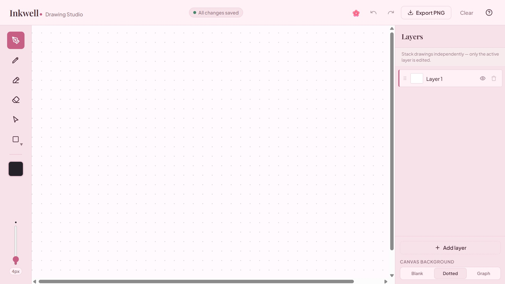

# Inkwell

> An archival, fine-art-inspired browser drawing studio built for deliberate craftsmanship and fluid creative flow.

**Live demo:** [Open Inkwell](https://inkwelldrawingstudio.netlify.app/)  
**Source code:** [GitHub repository](https://github.com/beella5/inkwell)

---

## Project Overview

Inkwell is a browser-based drawing studio inspired by the tactile warmth of a traditional fine-art workspace. It provides a focused canvas for sketching, creating geometric shapes, organizing artwork into layers, and exporting finished drawings.

The application is built with React and Vite. Drawings are saved locally in the browser, so no account or backend database is required.

---

## Screenshot



---

## Features

### Drawing tools
- Freehand pen, pencil, highlighter, and eraser.
- Geometric shapes, including rectangles, circles, lines, triangles, and arrows.
- Eyedropper for sampling canvas colors.
- Curated color palette and custom color picker.
- Adjustable brush size.

### Editing and organization
- Undo and redo.
- Multiple layers with add, delete, rename, visibility, and reorder controls.
- Selection tools to move, resize, and delete drawing elements.
- Blank, dotted, and graph canvas backgrounds.
- Light, dark, and pink themes.

### Saving and exporting
- Automatic saving to browser `localStorage`.
- Restore the saved drawing when the application is reopened in the same browser.
- PNG export that includes the selected background and visible layers.
- Save-status feedback in the interface.

### Input and accessibility
- Mouse, touch, and stylus input through pointer events.
- Keyboard shortcuts for common drawing and editing actions.
- Shortcuts are suppressed while typing in text fields.

---

## Technology Stack

- React 18
- Vite 5
- JavaScript
- HTML Canvas API
- CSS
- Vitest and jsdom for automated tests

---

## Getting Started

### Prerequisites
- Node.js 18 or later
- npm

### Installation

Clone the repository and install its dependencies:

```bash
git clone https://github.com/beella5/inkwell.git
cd inkwell
npm install
```

### Run locally

```bash
npm run dev
```

Vite will print the local development URL in the terminal (usually `http://localhost:5173`).

### Run the tests

```bash
npm test
```

The current automated tests cover history behavior, serialization, and keyboard shortcuts.

### Create a production build

```bash
npm run build
```

The production files are generated in the `dist/` directory.

### Lint and format

```bash
npm run lint
npm run format
```

---

## Deployment

The live version is hosted on **Netlify**.

For a new Netlify deployment, connect the GitHub repository and use:

- **Build command:** `npm run build`
- **Publish directory:** `dist`

The project is a Vite single-page application. Configure the hosting platform to serve `index.html` for application routes if client-side routing is used.

---

## Known Limitations and Possible Future Improvements

- **Browser-local storage:** Drawings are stored in the current browser using `localStorage`. They are not automatically synchronized between devices or browsers. IndexedDB or optional cloud synchronization could support larger projects.
- **Layer controls:** Additional controls such as per-layer opacity and blend modes could provide more advanced compositing options.
- **Canvas navigation:** Zoom and pan controls, including pinch-to-zoom on touch screens, could improve work on larger drawings.
- **Additional export formats:** SVG export could complement the existing PNG export.

---

## Project Decisions and AI Disclosure

See [DECISIONS.md](./DECISIONS.md) for the architectural decisions, trade-offs, AI tools used during development, and an example of a change made to AI-generated output.
